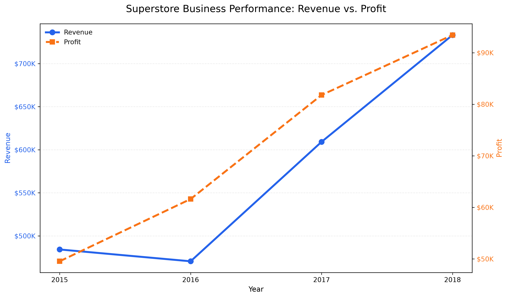
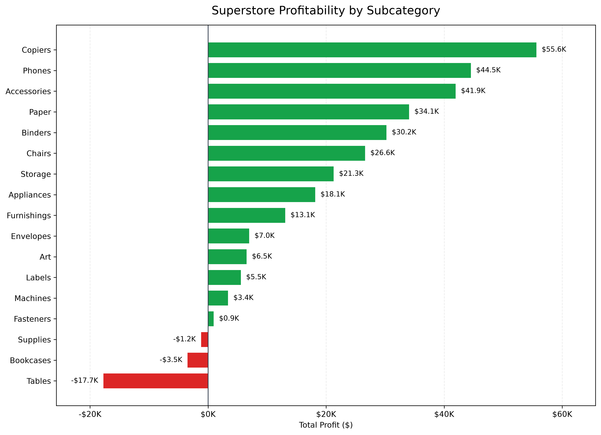
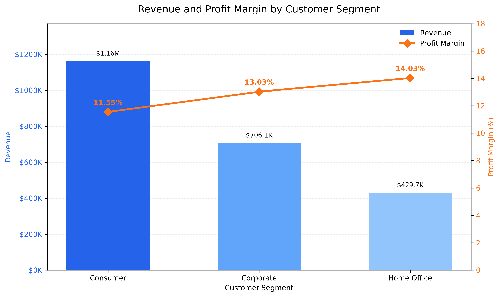

# Superstore Business Performance Analysis

**Core question:** Is revenue growth translating into profitable growth, and where should management investigate margin risk?

## Business Context

Revenue growth does not always translate into stronger profitability. This project uses PostgreSQL and SQL to analyze sales trends, product economics, customer performance, and transactions associated with significant losses.

The objective is to identify actionable business risks while distinguishing validated findings from hypotheses that require further investigation.

## Key Findings

- **Overall performance:** The dataset contains 9,994 product-line records across 5,009 orders and 793 customers, generating **$2.30M in revenue** and **$286.40K in recorded profit**, with a **12.47% profit margin**.
- **Growth versus profitability:** Between 2015 and 2018, revenue increased **51.4%** and profit increased **88.6%**. However, average order value declined approximately **13.0%**, and profit margin fell from 13.43% in 2017 to 12.74% in 2018.
- **Product-level risk:** Tables generated $206,965.53 in revenue but recorded a cumulative loss of $17,725.48. Bookcases and Supplies also recorded negative total profit.
- **Transaction-level risk:** Order `CA-2017-108196` recorded a loss of $6,892.37. A Cubify CubeX 3D Printer line accounted for approximately 95.8% of that order's loss.
- **Customer segments:** Consumer generated the highest total profit ($134,119.21), while Home Office had the highest segment margin (14.03%) and profit per active customer ($407.42).
- **Customer concentration:** The ten highest-revenue customers accounted for 6.70% of total revenue.

These findings identify areas for further commercial investigation. The analysis does not establish that discounts or other individual factors caused the observed losses.

## Visual Insights

### Annual Revenue and Profit
Revenue and profit both increased from 2015 to 2018, although revenue dipped in 2016 before recovering. Profit grew faster than revenue over the full period.

### Profitability by Subcategory
Tables, Bookcases, and Supplies recorded losses across the dataset. Copiers, Phones, and Accessories were among the largest contributors to total profit.

### Customer Segment Performance
Consumer generated the highest total revenue, while Home Office achieved the highest profit margin.

## Documentation & Analysis

Explore the supporting analysis, validation approach, and dataset setup:

- **[Findings Register](findings/findings_register.md)** — Validated findings, supporting figures, business implications, KPI definitions, and decision guardrails.
- **[Methodology](docs/methodology.md)** — Data validation approach, analytical principles, KPI calculations, and instructions for reproducing the analysis.
- **[Dataset Setup](data/README.md)** — Expected dataset structure, PostgreSQL table requirements, column names, and import guidance.
- **[SQL Analysis Scripts](sql/)** — Four SQL scripts covering data quality, sales trends, profitability drivers, and customer and segment performance.

## Analysis Scope

1. Data quality checks and KPI validation
2. Annual and monthly sales, profit, and margin trends
3. Product and subcategory profitability
4. Investigation of loss-making orders and products
5. Customer and segment economics
6. Interpretation limits and evidence-led follow-up priorities

## Tools

- **PostgreSQL** — querying and aggregation
- **SQL** — validation, business analysis, and window functions
- **Python (pandas, Matplotlib)** — Independent CSV validation and data visualization

## Repository Structure

| Directory/File | Purpose |
|---|---|
| `sql/` | Four numbered PostgreSQL analysis scripts |
| `findings/` | Validated findings, supporting evidence, and decision guardrails |
| `docs/` | Analysis methodology |
| `data/` | Dataset setup and import instructions |
| `visuals/` | Three charts covering annual performance, subcategory profitability, and customer segments |
| `create_visuals.py` | Python script for generating the project visualizations |

## Reproducing the Analysis

1. Read `data/README.md` for dataset requirements and import instructions.
2. Obtain the Sample Superstore dataset from an appropriate source.
3. Load the data into PostgreSQL using the documented table and column names.
4. Run the SQL scripts in numerical order.
5. Compare the results with `findings/findings_register.md`.

The SQL scripts expect the dataset to be available in `public.superstore` with the column names specified in the data setup instructions.

## Limitations

- Recorded profit may exclude acquisition, service, overhead, and other operating costs.
- Customer-level profit is not full customer lifetime value or net contribution after cost-to-serve.
- The dataset is observational; associations between discounts and losses do not establish causation.
- Customer activity and acquisition interpretations are limited by the dataset's available historical coverage.
- The source dataset's redistribution rights have not been confirmed. The raw CSV is therefore excluded from the repository.

## Project Status

The four SQL analysis scripts have been reviewed against their query results. The findings register and methodology are documented, and three Python-generated visualizations are included. Final repository validation and publication preparation remain.

---

## Contact

**Atik Zaman Riad**
Analyst | SQL • PostgreSQL • Python

- azrofficial20@gmail.com
- [LinkedIn](https://www.linkedin.com/in/atikzamanriad/)